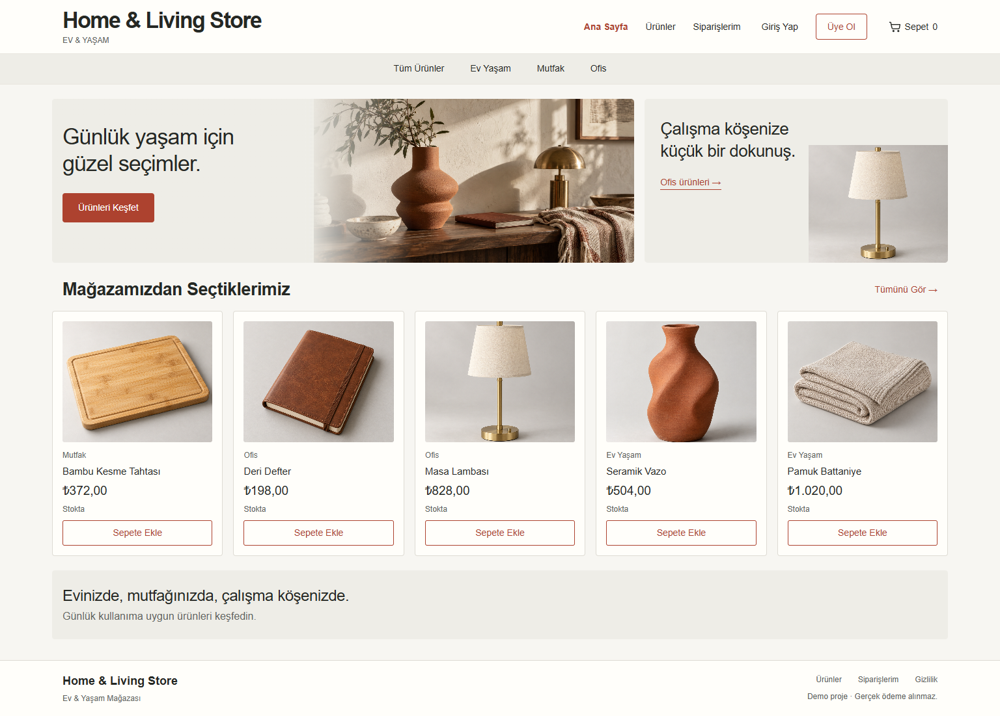

# Home & Living Store

.NET 10, ASP.NET Core MVC ve Bootstrap 5 ile hazırlanan Türkçe mağaza ve yönetim paneli. Kullanıcı ürünleri sepetine ekler, giriş yapar ve teslimat adresini yazarak sipariş oluşturur. Ödeme entegrasyonu bulunmaz.

Mağaza, hesap ve yönetim ekranları krem, kiremit ve koyu gri renklerle ortak bir tasarım kullanır. Bootstrap dosyaları proje içinde bulunur; arayüz için CDN bağlantısı gerekmez.

## Çalıştırma

Gereksinim: .NET 10 SDK. Node.js, SQL Server veya ayrı bir frontend kurulumu gerekmez.

Visual Studio'da `HomeLiveStore.slnx` dosyasını açıp `HomeLiveStore.Web` projesini başlangıç projesi olarak seçin. Windows'ta `Calistir.cmd` dosyası da mağazayı başlatır.

Debug profilinin adı `HomeLiveStore`, Web uygulamasının çalıştırılabilir çıktısı `HomeLiveStore.exe` olarak ayarlanmıştır. HTTPS profili `HomeLiveStoreHttps` adındadır.

```powershell
dotnet restore HomeLiveStore.slnx
dotnet run --project HomeLiveStore.Web --launch-profile HomeLiveStore
```

Mağaza: http://localhost:5100 — Yönetim: http://localhost:5100/Admin

Web uygulaması API controller'larını da barındırır; mağazayı kullanmak için ikinci bir süreç başlatmak gerekmez. API katmanını ayrıca çalıştırmak için:

```powershell
dotnet run --project HomeLiveStore.Api --launch-profile HomeLiveStoreApi
```

Bağımsız API: http://localhost:5101 — geliştirme OpenAPI sözleşmesi: `/openapi/v1.json`. Sağlık kontrolü: `/health`.

## Demo ve veri

Development ortamında örnek ürünler/kategoriler ve demo hesaplar ilk çalıştırmada oluşturulur. Admin hesabı: `admin@homelivestore.local` / `Admin123!`. Müşteri hesabı: `musteri@homelivestore.local` / `Musteri123!`. Mağazadaki kayıt ekranından kendi müşteri hesabınızı da oluşturabilirsiniz. Demo hesaplar yalnızca yerel ders gösterimi içindir; Production başlangıcında oluşturulmaz.

SQLite verileri çözüm klasörünün `App_Data/store.db` dosyasında saklanır. Veritabanı yolunu ortam değişkeniyle değiştirebilirsiniz:

```powershell
$env:ConnectionStrings__Store = 'Data Source=E:/Ders/veriler/magaza.db'
dotnet run --project HomeLiveStore.Web --launch-profile HomeLiveStore
```

## İşlevler

- Mağaza: kategori ve metin filtresi, sıralama, sayfalama, ürün detayı, sepet, kayıt/giriş/çıkış, sipariş oluşturma ve geçmişi.
- Yönetim: özet göstergeler, ürün/kategori ekleme-düzenleme-silme, fiyat/stok yönetimi, sipariş durumları ve kullanıcı listesi.
- Yetki: Customer yalnızca kendi siparişlerine erişir; Manager yönetim uç noktalarını kullanır.
- Sipariş: fiyat ve KDV sunucuda hesaplanır. Stok düşümü ve sipariş kaydı tek işlemde tamamlanır. Aynı istek kimliğiyle tekrar gönderim ikinci bir sipariş oluşturmaz.
- Durum: Hazırlanıyor → Kargoda → Tamamlandı. Hazırlanıyor durumundaki sipariş iptal edilebilir; stok bir kez geri eklenir.
- Geçmiş: sipariş satırları oluşturuldukları andaki ürün adını ve fiyatını saklar.
- Stok koruması: ürün güncellemesi, form açıldığındaki `originalStockAmount` değerini gönderir. Stok değiştirilmediyse aradaki satışlar korunur; eski stok üzerinden yapılan miktar değişikliği `409 Conflict` döndürür. Bu alanı göndermeyen güncelleme istekleri `400 Bad Request` döndürür.
- Sipariş güvenliği: gönderim sürerken adet, kaldırma ve adres kontrolleri kilitlenir. Başarısız istekte kontroller yeniden açılır; yeniden deneme aynı istek kimliğini kullanır.
- Adet sınırı: bir ürün için toplam sipariş adedi 1–999 arasındadır. Aynı ürünü farklı satırlarda göndermek bu sınırı değiştirmez; sepet aynı kuralı API'deki sabitten alır.
- Stok iadesi: iptal, stok alanının üst sınırını aşacaksa `409 Conflict` döner. Sipariş durumu ve bütün stok iadeleri aynı işlem içinde geri alınır.
- Arama: ürün adı, açıklama ve barkod araması büyük/küçük harf farkını ve Türkçe I/ı, İ/i karakterlerini dikkate alarak aynı sonuçları bulur.
- Ürün galerisi: yönetici kapak görseline ek olarak en fazla 10 görsel adresi ekler ve kaldırır. Ürün detayındaki sağ-sol okları, küçük görseller, klavye yön tuşları ve telefonda yatay kaydırma aynı galeriyi yönetir. Tek görselde gezinme araçları gizlenir.
- Görsel adresleri: `/images/` altında yerel dosya yolu veya HTTPS adresi kullanılır. API'deki `imagePaths` listesi sıralı kaydedilir; alan gönderilmezse mevcut görseller korunur, boş liste gönderilirse ek görseller kaldırılır. Mevcut `ProductImages` tablosu kullanılır; şema değişikliği gerekmez.

Ürün yönetimindeki fiyat KDV hariçtir; mağazadaki satış fiyatı KDV dahildir. Sipariş akışında banka/kart bilgisi istenmez.

## Katmanlar

| Proje | Sorumluluk |
|---|---|
| Domain | Varlıklar, roller ve sipariş kuralları |
| Application | DTO'lar, servis sözleşmeleri ve doğrulama |
| Infrastructure | EF Core, SQLite, veri erişimi ve servis uygulamaları |
| Api | Kimlik doğrulama, yetki ve HTTP uç noktaları |
| Web | MVC sayfaları, mağaza/admin arayüzü ve aynı origin API hostu |

## Arayüz

- Ana sayfa, katalog, ürün detayı, giriş, kayıt, sepet, sipariş listesi ve detayı ortak menü ve alt bilgiyi kullanır.
- Yönetim panelinde genel bakış, ürünler, kategoriler, siparişler ve kullanıcılar aynı tablo ve form düzenini paylaşır.
- `HomeLiveStore.Web/Views/Shared/_Layout.cshtml` ortak sayfa yapısını, `wwwroot/css/site.css` renkleri ve duyarlı yerleşimi içerir.
- `wwwroot/js/site.js`, sayfalardaki `data-*` alanlarını API yanıtlarıyla doldurur. Kategori bağlantıları gerçek kategori kimlikleriyle çalışır.
- Giriş ekranındaki etiketler, ana sayfa başlıkları ve marka aynı içerik hizasından başlar. Küçük ekranlarda menü açılır, kartlar ve formlar alt alta yerleşir.
- Ürün fiyat sınırları, Türkçe ve İngilizce gibi farklı sistem kültürlerinde aynı sayısal değerlerle doğrulanır.

### Ekran görüntüleri



[Giriş ekranı](docs/screenshots/login-desktop.png) · [Yönetim paneli](docs/screenshots/admin-dashboard-desktop.png) · [Mobil görünüm](docs/screenshots/home-mobile.png)

## API kullanımı

API cookie oturumu kullanır. Önce `GET /api/auth/csrf` çağrısındaki `token` değerini alın; cookie'leri saklayın ve POST/PUT/DELETE isteklerinde `X-CSRF-TOKEN` başlığı gönderin. Giriş/kayıt/çıkış sonrasında tokenı yenileyin.

```http
POST /api/orders
Content-Type: application/json
X-CSRF-TOKEN: <csrf yanıtındaki token>
Cookie: <istemcinin sakladığı cookie'ler>

{
  "deliveryAddress": "Örnek Mahallesi Ders Sokak No: 10 İstanbul",
  "requestId": "c9208545-c9d2-4753-a42d-55b847a9f2eb",
  "orderLines": [{ "productId": 1, "quantity": 2 }]
}
```

Sepeti değiştirdiğinizde yeni bir `requestId` oluşturun; aynı siparişi ağ hatasından sonra tekrar gönderirken mevcut kimliği koruyun. İstemciden fiyat, toplam veya kullanıcı kimliği gönderilmez.

Uç noktalar ve alanlar: [API ve ekran sözleşmesi](docs/superpowers/specs/2026-09-11-store-design.md).

Son galeri, adlandırma ve tarayıcı kontrolleri: [Doğrulama raporu](docs/superpowers/gallery-verification.md).

Son hata düzeltmeleri ve ek regresyon sonuçları: [Hata düzeltme raporu](docs/superpowers/bugfix-verification-2026-10-19.md).

## Doğrulama

Paket bağımlılığı olmayan console testleri gerçek HTTP hostunu, cookie oturumlarını ve SQLite veritabanını kullanır. PowerShell 7 ile:

```powershell
pwsh -File scripts/verify.ps1
```

Komut çözümü derler, domain kontrollerini ve HTTP kabul testlerini çalıştırır. Test veritabanı ve loglar ayrı `App_Data/checks/<run-id>/` klasörüne yazılır; mağazanın veritabanı etkilenmez.

İsteğe bağlı tarayıcı regresyonları için Node.js 20 veya üzeri ve Microsoft Edge gerekir:

```powershell
npm ci --prefix tests/BrowserChecks
pwsh -File scripts/verify.ps1 -BrowserChecks
```

Bu ek testler de aynı geçici host ve ayrı veritabanını kullanır. Uygulamayı normal çalıştırmak için Node.js gerekmez.

Açık bir geliştirme hostunda HTTP kontrollerini elle çalıştırmak için (test ürünleri ve hesapları oluşturur):

```powershell
dotnet run --project tests/IntegrationChecks -- http://localhost:5100
```

## Başvuru kaynakları

Host bileşimi ve güvenlik akışı Microsoft'un [MVC Application Parts](https://learn.microsoft.com/en-us/aspnet/core/mvc/advanced/app-parts?view=aspnetcore-10.0), [.NET 10 cookie/API yanıtları](https://learn.microsoft.com/en-us/aspnet/core/breaking-changes/10/cookie-authentication-api-endpoints?view=aspnetcore-10.0), [CSRF koruması](https://learn.microsoft.com/en-us/aspnet/core/security/anti-request-forgery?view=aspnetcore-10.0) ve [SQLite işlemleri](https://learn.microsoft.com/en-us/dotnet/standard/data/sqlite/transactions) belgelerine göre düzenlenmiştir.
